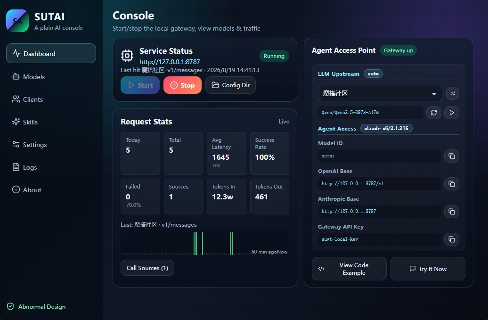
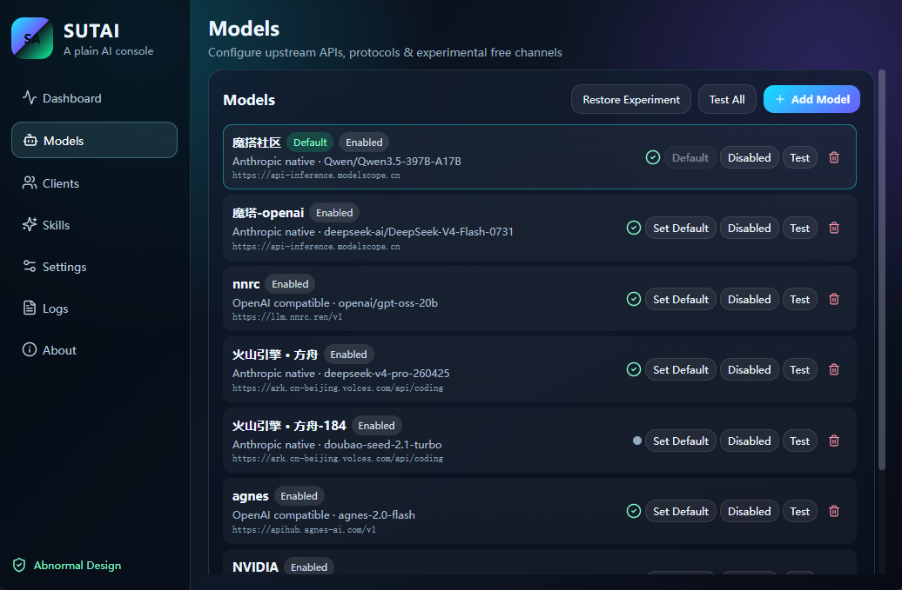
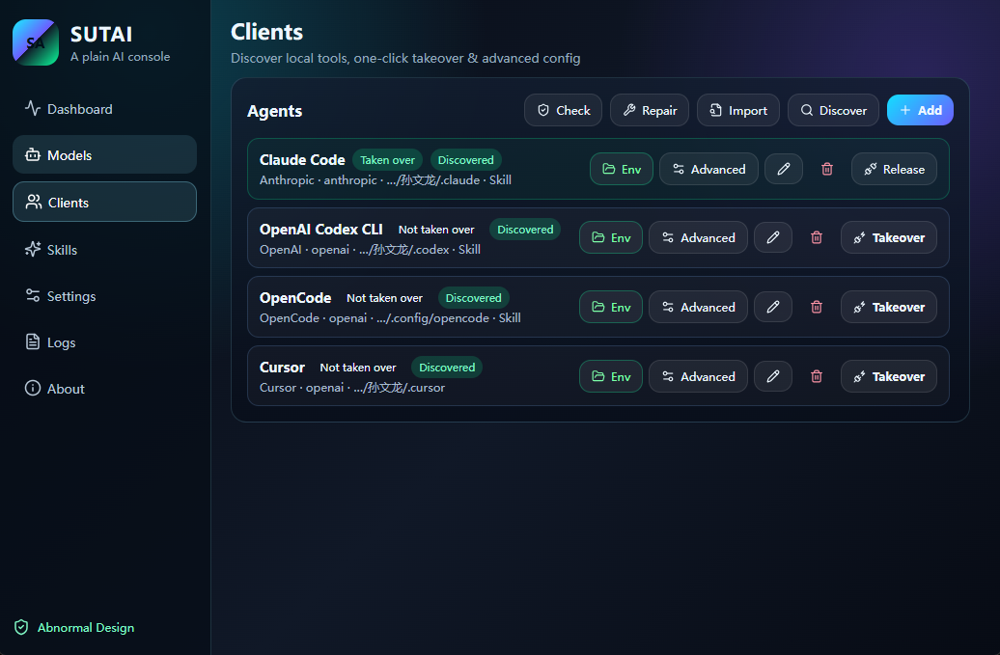
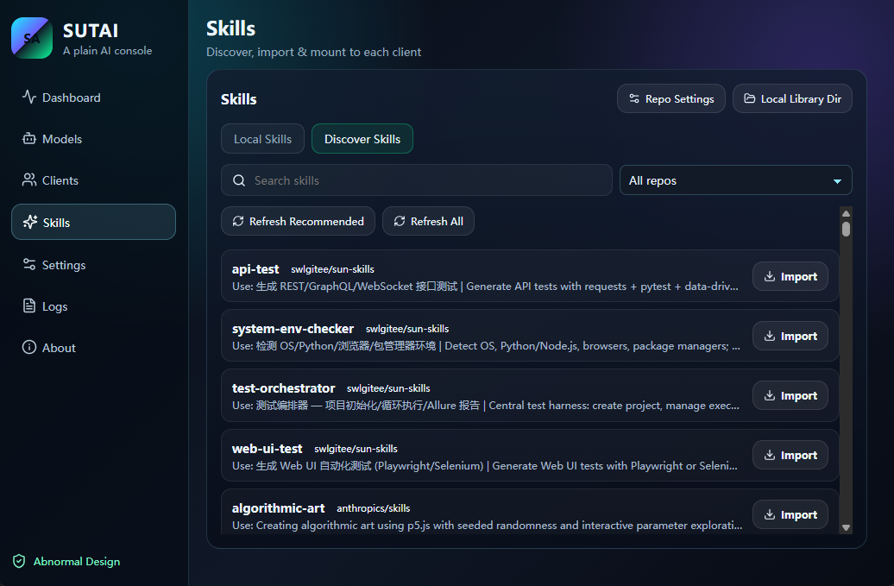
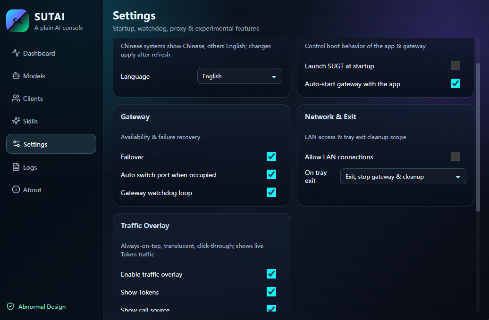
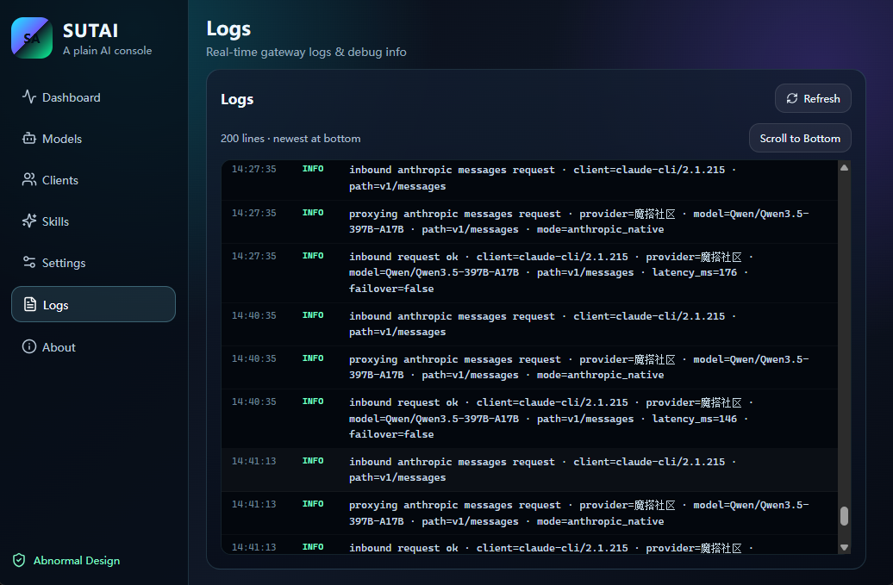

# SUGT — Local AI Workbench (Gateway · Skills · Agent Console)

> 中文文档见主 README：**[README.md](README.md)**。

**SUGT** (su gateway) is more than a local proxy port — it is an **on-device AI workbench**: one control plane for how upstream models connect, how coding agents attach, how skills are managed, and how rules are injected. OpenAI / Anthropic / ModelScope / Volcengine / SiliconFlow / Kimi / DeepSeek / self-hosted models share one local endpoint; Claude Code, Codex, OpenCode and friends get one-click takeover; skills stay discoverable, installable, and mountable without losing the library; plus strategy boxes, rewrite rules, access keys, LAN WebUI, and the desktop companion su.

Who it is for: developers who juggle several agents and upstreams, want Base URLs and keys consolidated on localhost, and need skills/rules to travel with them.

- **One local entry**: clients only need the local Base URL + an access key; swapping upstreams does not mean editing every agent.
- **Protocol & resilience on the gateway**: Chat / Anthropic / Responses bridging, failover and free-route switching that try to keep agent sessions alive.
- **Skills & rules that stick**: durable skill library; global inject + request rewrite; inbound access keys kept separate from upstream key rotation.
- **Local-first**: loopback by default; LAN / WebUI are opt-in; no accounts, no cloud relay.

| | |
| --- | --- |
| Author | Sun Wenlong · [异常设计](https://github.com/lsuen) |
| Status | Open to full-time / collaboration opportunities (2026-11-20); introductions welcome via [Issues](https://github.com/lsuen/sugt/issues) or the profile on this repo |
| Open source | [Apache-2.0](LICENSE), fully open source |
| Releases | [GitHub Releases](https://github.com/lsuen/sugt/releases) |

## License

The [GitHub Releases](https://github.com/lsuen/sugt/releases) build is the full product: local gateway, protocol bridging, client takeover, skills console, rules / strategy, access keys, and SOUL / su. Source is Apache-2.0.

## Why

- **Keys and endpoints scatter** across clients — changing a model means editing a dozen places.
- **Agent protocols differ** — Chat, Anthropic Messages, and Responses mixed together; a thin proxy breaks tool loops.
- **Skills and rules do not travel** when you switch machines or clients.

SUGT’s bet: make the **access surface** thick (takeover, keys, rules, skills, strategy) while keeping the gateway predictable and local — not another cloud aggregator.

SUGT does not position itself as a "free-token aggregator." Free tiers are for experimenting and backup; reliable output still calls for paid models. We are not in the business of farming free quotas and make no "unlimited free" promises. SUGT solves the **last mile** — making model governance (access, strategy boxes, rule constraints, and the skills ecosystem) controllable, portable, and ready to use.

## Features

### Console layout

Sidebar has two layers: **facade** = Console + SOUL, then a divider, then the tool layer = Gateway / Rules / Access / Skills / Settings.

| Group | Leaves |
| --- | --- |
| Console | Start/stop, traffic, real LLM endpoint reports |
| SOUL | Read-only orchestrator companion |
| Gateway | Model config · Model list · Strategy box · Upstream key rotation |
| Rules | Inject · Rewrite rules |
| Access | Clients · **Access keys** |
| Skills | Discover / install / mount (first-class tab, not under Access) |
| Settings | Overview / General / Appearance / Advanced / Companion / Logs / About |

Overview is read-only (service state, LAN share, endpoints, build). Log polling runs only while the Logs sub-tab is visible.

**Two key systems — do not mix them:**

- **Access keys** (Access → Access keys): inbound keys clients present to this local gateway. Multi-key, enable/disable, usage by client/IP. The **primary** key syncs to `config.toml` `gateway_client_api_key` and the access-info card — edit keys here; do not add a second editor under Settings.
- **Upstream key rotation** (Gateway → Upstream key rotation): provider API-key pools and quotas for outbound calls. Unrelated to inbound auth.

### Local AI Gateway

- Axum HTTP server embedded in the Tauri process, speaking **OpenAI Chat Completions**, **Anthropic Messages**, and **OpenAI Responses**
- **Protocol bridging**: bidirectional request / response conversion between Anthropic and OpenAI, including SSE streaming
- **Multi-upstream failover**: automatically falls back to the next provider in your `failover` order; experimental free channel also failovers across candidate models on Chat and Responses paths
- **Hot-reload config**: edit `config.toml` and the next request picks it up — no restart needed
- **Port fallback**: preferred listen port is editable under Settings → General; when busy, try fallback ports (default `9878/18887/28887`, editable under Advanced). The runtime listen port may differ from preferred, but **no longer overwrites the preferred value in config**; the console shows preferred vs listen when they diverge
- **LAN share**: enable “Allow LAN connections” to bind `0.0.0.0` and copy LAN Base URL / API Key in one click
- Built-in endpoints: `/health`, `/v1/models`, `/v1/_sugt/traffic`, `/v1/_sugt/workspace-rules`, `/v1/_sugt/notify`

> Engineering follow-ups (not UI copy): request repair/retry (empty tool names, etc.), slim tools/instructions for weak upstreams, context compaction near window limits, stable prefixes for upstream prompt cache. SOUL and full agent clients share this gateway layer.

### Model Management

- **Model config**: built-in Chinese provider catalog (ModelScope, Volcengine, SiliconFlow, Moonshot Kimi, DeepSeek, …), enable/disable, default model, connectivity tests — keep this page separate from Model list
- **Model list**: registry view that hides disabled models; header shows local access info (Base URL / key) with copy
- **Strategy box**: optional strategy boxes for routing with health written back to the console
- Experimental free channels: auto-probe when opening the console or selecting that upstream; per-route real latency tests. Settings → Advanced toggles “fetch and test” for free vs custom channels separately

### One-Click Agent Takeover

- Lives under **Access → Clients**. A single catalog of 22 known clients (Chinese and global: Claude Code, Codex, CodeBuddy, Trae, Lingma, iFlow, Kimi CLI, Qoder, Comate, CodeGeeX, Windsurf, Cline, Copilot CLI, Kiro, Goose, Factory Droid, and more). Discovery lists the whole catalog even with an empty query, so a client does not need local traces before you can pick and take it over. Unconfirmed clients declare env-var capability only, never a fake config-file write
- Claude Code / OpenCode: environment variables and launch scripts point at the local gateway; releasing the takeover cleans them up
- **Codex (CLI / Desktop)**: writes `~/.codex/config.toml` with `model_providers.sugt` (`wire_api = "responses"`, `requires_openai_auth = false`, local compaction capabilities) and disables hosted `web_search` when the user has not configured it; `model` gets a `sugt-` alias so the client does not inherit the official `code_mode_only` / `use_responses_lite` tool protocol (disable with `SUGT_CODEX_MODEL_ALIAS=off`); `auth.json` only overrides the auth mode and gateway key, preserving existing login fields. When the upstream has no native Responses API, the gateway bridges to Chat Completions: flattening namespace tools and restoring their names on the way back, classifying function/custom tools by their declarations, preserving structured tool results and pairing orphan calls, and emitting the full SSE lifecycle events. Responses fields that cannot be forwarded are degraded observably; empty/invalid upstream bodies and 4xx replies produce Responses-shaped failure objects instead of fake empty successes; streaming tolerates late tool names, out-of-order indexes, malformed arguments and multibyte characters split across chunks; historical `tool_calls.arguments` are canonicalized to JSON object strings, free-route 400 becomes Switch (not circuit), and the circuit breaker trips only on auth failures. MCP servers remain owned by the client's own `[mcp_servers]` table; SUGT does not manage them

### SOUL / su

- A lightweight companion on the **SOUL** tab — the soul of the app, not a separate “gateway agent”
- Chat, create small projects under the local projects folder, write files, and edit app or system config with confirm-before-write (macOS defaults to `~/Library/Application Support/sugt/projects/`, away from iCloud Documents)
- Optional **auto-approve writes** for trusted sessions; after a write, su re-reads the file to verify
- Long shell output is trimmed (head + tail kept) so context stays usable on larger projects
- Reasons with **your** configured upstream model through the local gateway; paste screenshots when the model supports vision
- Separate chat history per working place; stop a run mid-flight; hand heavier work to Claude Code or Codex
- **Management intents are read-only routing**: su is given live facts (known clients, taken-over clients, installed skills, repos) and can suggest one of Clients / Skills / Takeover preview / Settings as a clickable card. It never writes client configs, clones repos or installs skills itself — takeover, install and mount stay on deterministic commands with an impact preview and your confirmation. All of this works with the model unavailable, minus the suggestions

### Skills Console

- Refresh skill indexes from Git repositories, Gitee, or custom sources
- Paste a GitHub / Gitee / GitLab / Bitbucket / GitCode URL to install skills directly into Local Skills: host allowlist, shallow clone (proxy-aware, `main` → `master` fallback), `SKILL.md` scan, atomic landing, transactional rollback on failure, idempotent ids. The UI then guides you to Local Skills to mount them to an agent
- Trigger words are read from `SKILL.md` frontmatter (`triggers` / `触发词` / `when_to_use`, comma-separated or YAML list) and shown as chips; the rule-based "optimization advice" dialog explains missing metadata and how to fix it. No invented triggers, no model required
- Install, uninstall, mount, and unmount Skills — your library is always preserved
- Mount the same Skill across multiple agents; Markdown-rendered skill panels

### LAN WebUI

- With one machine running the gateway, any device on the same LAN can manage it from a browser — no Internet relay, no accounts, no cloud.
- Covers providers, skills, clients, access keys, upstream key rotation, logs, rules and takeover profiles — the same management surface as the desktop GUI.
- Login uses the inbound primary key (`gateway_client_api_key`); the management bind follows the LAN toggle and does not expose all interfaces by default.
- CLI: `sugt-cli serve --lan --webui` (temporary, does not write config). GUI: persistent switch in Settings (WebUI port editable there). See [LAN WebUI guide](docs/局域网WebUI管理.md).

### Traffic Overlay

- Always-on-top, semi-transparent, mouse-through overlay showing today's token activity in real time
- Landscape / portrait layout, resizable, with one-click restore to defaults
- macOS: overlay position and mouse-through behave with the local desktop

### Workspace Rules

- **Rules → Inject**: three independent switches for rules text, document habits, and webhook; enabled text/habits are injected into OpenAI / Anthropic / Responses traffic (soft prompt)
- A fresh config includes a short general-purpose draft (off until enabled) and checks `AGENTS.md` plus `docs/MAP.md` by default
- Webhook stays off by default; the URL stays local and is relayed by `/v1/_sugt/notify`, never into model context
- **Rules → Rewrite**: request-rewrite engine (model / headers / body, etc.) sits beside inject — not a substitute for it

### Gateway Watchdog

- Detects gateway unavailability every 20 seconds and restarts it automatically
- Manages a detached `sugt-cli serve` process via PID file (no window, background-only)

### Appearance / Themes

- Built-in skins: Cyber Console, Street, Skate, Brickyard, Shan-shui, HIPHOP, Jazz Night, plus **Anime Boy** / **Anime Girl** (illustrated backdrops with frosted glass panels)
- Themes are **one CSS file (or JSON pack) each** on a fixed ~40-token contract — background images, translucent surfaces, and `backdrop-filter` glass included
- Settings → Appearance to switch; import a `theme.json`, a `.zip` or a whole folder; overlay a custom background without changing colors
- Status bar is on by default and opens a solid log drawer; full logs live in Settings → Logs
- Authoring guide: [docs/THEME_AUTHORING.md](docs/THEME_AUTHORING.md) · Agent rules: [AGENTS.md](AGENTS.md)

## Screenshots

Console — start/stop, traffic, agent endpoints.



Models — providers, default model, connectivity test.



Clients — discover agents, take over or release.



Skills — local mount and repo discovery.



Settings — Overview, language, gateway, appearance, and overlay options.



Settings → Logs — request and gateway activity.



## Internationalization

SUGT ships with built-in **English / 中文** support. All UI text is rendered through a single dictionary layer with zero third-party dependencies.

**Switching languages**: open **Settings → General → Language** and pick one of:

| Option | Behavior |
| --- | --- |
| Follow system | Uses the OS language: Chinese systems show 中文, everything else shows English (default) |
| 中文 | Always shows Chinese |
| English | Always shows English |

The UI refreshes immediately after switching — every panel, dialog, toast, and the traffic overlay updates with no gaps. The choice is persisted locally and survives restarts.

**Implementation notes**:

- All copy lives in the `zh` / `en` dictionaries in `src/i18n.ts`; components read it via `t('namespace.key')`
- `{variable}` interpolation is supported for dynamic text (token counts, provider names, paths)
- The preference is stored in `localStorage`, consistent with theme and other UI preferences
- Adding a new language is a dictionary extension — no component changes required

## Getting Started

### Install

**Windows (winget)** — once the manifest merges upstream:

```bash
winget install lsuen.SUGT
```

**Windows (direct)** — from [GitHub Releases](https://github.com/lsuen/sugt/releases): `SUTAI-windows-x64-setup.exe` (NSIS installer) or `SUTAI-windows-x64.zip` (portable).

**macOS (Homebrew)** — rolling-release cask from the open-source tap:

```bash
brew tap lsuen/homebrew-sugt
brew trust --cask lsuen/homebrew-sugt/sugt   # Homebrew 6.0+ requires explicit trust for third-party taps
brew install --cask sugt

# later: reinstall whatever is currently latest
brew upgrade --cask --greedy sugt
```

The cask uses `version :latest` with a fixed download URL, so a new SUGT release never needs a tap update. Skip `brew trust` on Homebrew < 6.0.

Launch from Applications as **SUTAI**. The app is unsigned: on first launch, right-click → **Open**, or run `xattr -cr "/Applications/SUTAI.app"`.

**Linux (headless gateway / server)** — download `SUTAI-linux-x64.tar.gz` or `SUTAI-linux-arm64.tar.gz`. Each archive contains `sugt-cli` plus a systemd unit sample:

```bash
tar -xzf SUTAI-linux-x64.tar.gz
./sugt-cli serve --lan --port 8787   # LAN-reachable; omit --lan to stay on 127.0.0.1
```

Non-loopback binds **require** a client API key (`Authorization: Bearer …` or `x-api-key`). Change `gateway_client_api_key` in config before sharing on a network. See `sugt-gateway.service` in the tarball or [`deploy/sugt-gateway.service`](deploy/sugt-gateway.service). There is **no** Linux desktop GUI package yet.

**Release packages (stable names).** Asset filenames never carry a version number — only the git tag does:

| Platform | Asset |
| --- | --- |
| Windows installer | `SUTAI-windows-x64-setup.exe` |
| Windows portable | `SUTAI-windows-x64.zip` |
| macOS Apple Silicon | `SUTAI-macos-arm64.zip` |
| macOS Intel | `SUTAI-macos-x64.zip` |
| Linux CLI x86_64 | `SUTAI-linux-x64.tar.gz` |
| Linux CLI arm64 | `SUTAI-linux-arm64.tar.gz` |
| SHA256 list | `SUTAI-checksums.txt` |

`https://github.com/lsuen/sugt/releases/latest/download/<asset>` therefore always resolves to the newest build. The download site, the Homebrew cask and the in-app updater all read `/releases/latest`, so publishing a new version only replaces the same-named assets — no link or config changes anywhere. Tags stay semantic (`v1.1.9`) because the in-app updater compares the tag with the bundled `CARGO_PKG_VERSION`; a fixed `latest` tag would silently disable update checks. Windows, both macOS architectures and Linux CLI builds are produced by `.github/workflows/release.yml` on every `v*` tag push.

**In-app updates:** Settings → About → Check for Updates. Fallback order is direct GitHub → your configured GitHub proxy → built-in/remote mirrors. Windows can silent-install the NSIS package; macOS replaces the `.app` when writable, otherwise opens the download folder for a manual drag into Applications. Homebrew / winget remain install channels.

Config dir: Windows / Linux default to `Documents/.sugt/`; macOS defaults to `~/Library/Application Support/sugt/` (auto-migrates from legacy `Documents/.sugt` when Documents is iCloud-synced). Override with `SUGT_CONFIG_DIR`.

### CLI

```bash
sugt-cli status
sugt-cli serve --host 127.0.0.1 --port 8787
sugt-cli serve --lan --port 8787          # LAN/server: bind 0.0.0.0, require client key
sugt-cli serve --lan --webui              # + browser-based admin UI on port 8788 (this run only)
sugt-cli webui on --port 8788             # persist the WebUI setting for GUI startup
sugt-cli webui off | status               # disable / inspect the persisted setting
sugt-cli env        # takeover management
sugt-cli test       # connectivity test
```

`--webui` / `--webui-port` affect only the current run (like `--port`); use the `webui` subcommand or the GUI Settings switch for persistence. Open `http://<LAN-IP>:8788` and log in with `gateway_client_api_key`. See [LAN WebUI guide](docs/局域网WebUI管理.md).

> On macOS the CLI ships inside the app bundle at `SUTAI.app/Contents/MacOS/sugt-cli`. Linux releases ship the CLI only.

## Build from Source

Requirements: Windows 10/11, Node 18+, Rust 1.78+. On macOS, Xcode Command Line Tools and Node are required.

```bash
npm install
npm test             # theme contract + import smoke + TypeScript check
npm run dev:app      # launch the Tauri app in dev mode
```

Production build:

```bash
npm run build        # frontend production build
npm run build:web    # embed LAN WebUI into sugt-cli; skip only if WebUI is not needed
npx tauri build      # full desktop bundle
cd src-tauri && cargo build --release --bin sugt-cli   # standalone CLI
```

Run `npm run build:web` before building `sugt-cli`. Otherwise the embedded WebUI is the placeholder page.

Full verification (frontend plus Rust library and integration tests):

```bash
npm test
cd src-tauri && cargo test
```

## Tech Stack

| Layer | Choice |
| --- | --- |
| Desktop shell | Tauri 2.9 (WebView2 on Windows / WKWebView on macOS) |
| Frontend | React 18 + TypeScript 5.7 + Vite 6 |
| Backend | Rust (edition 2021) + Axum 0.7 |
| Gateway | Embedded Axum HTTP server, OpenAI / Anthropic protocol bridging |
| CLI | `sugt-cli` (standalone binary: `serve` / `status` / `test` / `env` / `init` / `webui`) |
| LAN WebUI | Independent Axum listener + embedded SPA; RPC over `/api/invoke`, HMAC session from gateway key |

## Feedback & Contributions

Questions and suggestions are welcome — open an [Issue](https://github.com/lsuen/sugt/issues). The project is under active polish; a star is the best encouragement.

## License

[Apache-2.0](LICENSE) · [NOTICE](NOTICE)
