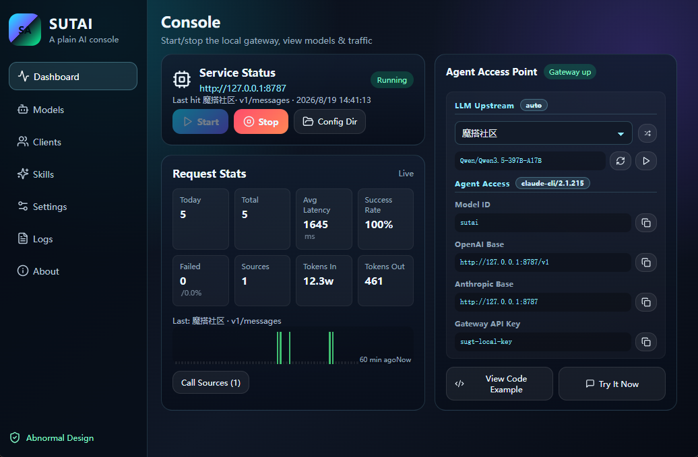
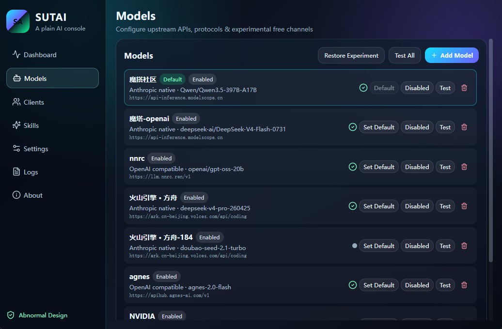
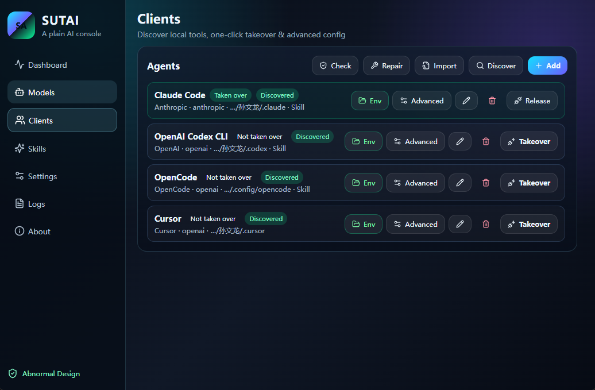
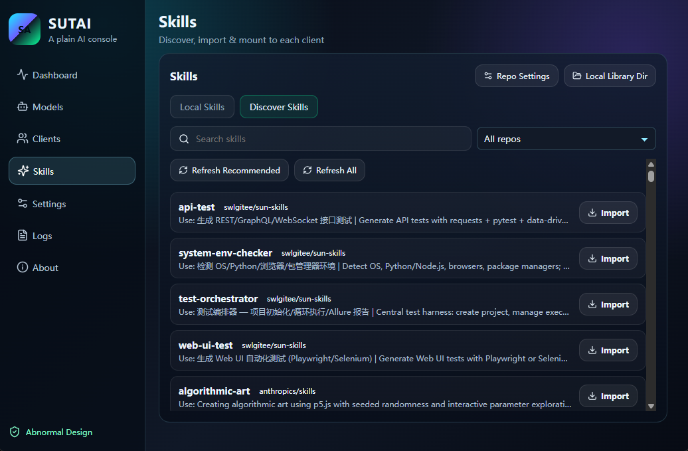
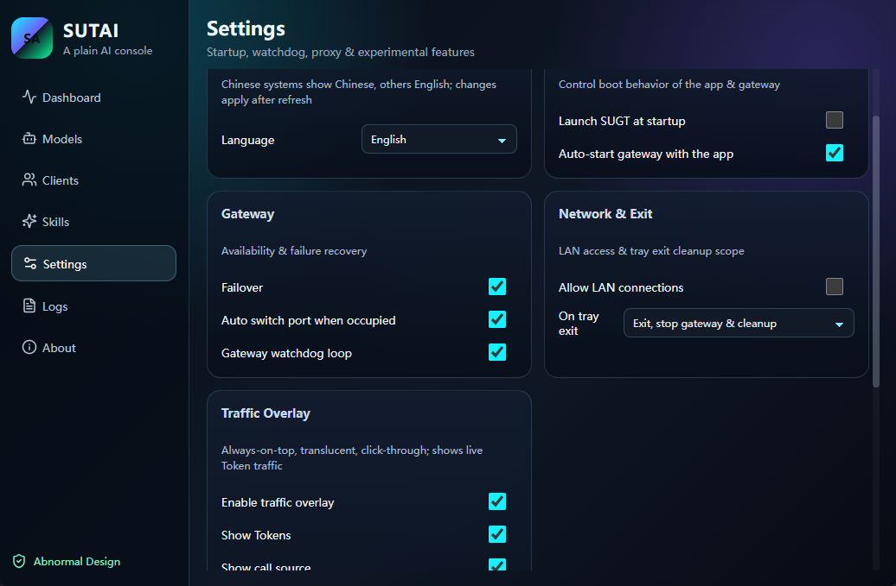
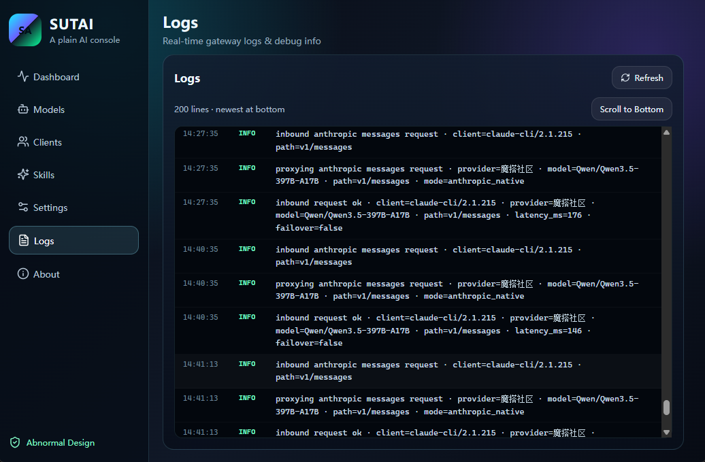

# SUGT — Local AI Gateway & LLM Skill Console

**SUGT (su gateway)** is a local AI gateway and skills control plane for your desktop. It centralizes API keys from multiple LLM providers (OpenAI, Anthropic, ModelScope, Volcengine, SiliconFlow, Moonshot Kimi, DeepSeek, DashScope, and self-hosted) behind a single OpenAI / Anthropic-compatible proxy, so Claude Code, Codex, OpenCode, and other AI coding clients all talk to one local endpoint — while you swap upstream models in a single panel. It also ships a Skills console for discovering, installing, and mounting Skills without losing your library.

- **One key set, everywhere**: Base URLs and auth are consolidated into one local gateway.
- **Swap upstreams freely**: OpenAI, Anthropic, ModelScope, Volcengine, SiliconFlow, Moonshot Kimi, DeepSeek, or your own models — no client-side reconfiguration.
- **Skills that stick**: discover, install, and mount Skills; unmounting never loses your library.

|                |                                                                       |
| -------------- | --------------------------------------------------------------------- |
| Author         | Sun Wenlong · [异常设计](https://github.com/lsuen)                       |
| Open source    | [Apache-2.0](LICENSE), fully open source                                |
| Releases       | [GitHub Releases](https://github.com/lsuen/sugt/releases)                |

中文文档：[README.zh.md](README.zh.md)

## License

The release on [GitHub Releases](https://github.com/lsuen/sugt/releases) is the full product: local AI gateway, protocol translation, client takeover, Skills console, and the in-app SOUL companion. Source is Apache-2.0.

## Why

- **API keys scattered** across OpenAI, Anthropic, ModelScope, Volcengine, Moonshot Kimi, DeepSeek, local models...
- **Every agent wants its own Base URL and auth setup** — re-editing configs in each client is tedious and error-prone
- **Skills live in different folders** with no shared discover / mount / keep flow; switching machines means redoing everything

SUGT is intentionally small: a compatible local gateway, one-click takeover for common agents, and a skill control plane you can actually keep.

## Features

### Console layout

Seven main tabs: Dashboard, Models, Clients, Skills, SOUL, Rules, Settings. Logs and About moved **into Settings**, which now has six sticky horizontal sub-tabs — **Overview** (first), General, Appearance, Advanced, Logs, About. Overview is read-only and shows service state, LAN sharing status/URLs/key/model, active upstream, endpoints and build id, plus shortcuts into the relevant sub-tabs. Log polling only runs while the Logs sub-tab is visible.

### Local AI Gateway

- Axum HTTP server embedded in the Tauri process, speaking **OpenAI Chat Completions**, **Anthropic Messages**, and **OpenAI Responses**
- **Protocol bridging**: bidirectional request / response conversion between Anthropic and OpenAI, including SSE streaming
- **Multi-upstream failover**: automatically falls back to the next provider in your `failover` order; experimental free channel also failovers across candidate models on Chat and Responses paths
- **Hot-reload config**: edit `config.toml` and the next request picks it up — no restart needed
- **Port fallback**: if the configured port is taken, the gateway binds the next available one
- **LAN share**: enable “Allow LAN connections” to bind `0.0.0.0` and copy LAN Base URL / API Key in one click
- Built-in endpoints: `/health`, `/v1/models`, `/v1/_sugt/traffic`, `/v1/_sugt/workspace-rules`, `/v1/_sugt/notify`

> Engineering follow-ups (not UI copy): request repair/retry (empty tool names, etc.), slim tools/instructions for weak upstreams, context compaction near window limits, stable prefixes for upstream prompt cache. SOUL and full agent clients share this gateway layer.

### Model Management

- Built-in catalog of Chinese providers (ModelScope, Volcengine, SiliconFlow, Moonshot Kimi, DeepSeek, and more) with standard Base URLs and model lists
- Enable / disable providers, switch the default model, and test connectivity from one panel
- Experimental free channels: auto-probe once when you open the console or select that upstream (no background polling); refresh manually anytime

### One-Click Agent Takeover

- A single catalog of 22 known clients (Chinese and global: Claude Code, Codex, CodeBuddy, Trae, Lingma, iFlow, Kimi CLI, Qoder, Comate, CodeGeeX, Windsurf, Cline, Copilot CLI, Kiro, Goose, Factory Droid, and more). Discovery lists the whole catalog even with an empty query, so a client does not need local traces before you can pick and take it over. Unconfirmed clients declare env-var capability only, never a fake config-file write
- Claude Code / OpenCode: environment variables and launch scripts point at the local gateway; releasing the takeover cleans them up
- **Codex (CLI / Desktop)**: writes `~/.codex/config.toml` with `model_providers.sugt` (`wire_api = "responses"`, `requires_openai_auth = false`, local compaction capabilities) and disables hosted `web_search` when the user has not configured it; `model` gets a `sugt-` alias so the client does not inherit the official `code_mode_only` / `use_responses_lite` tool protocol (disable with `SUGT_CODEX_MODEL_ALIAS=off`); `auth.json` only overrides the auth mode and gateway key, preserving existing login fields. When the upstream has no native Responses API, the gateway bridges to Chat Completions: flattening namespace tools and restoring their names on the way back, classifying function/custom tools by their declarations, preserving structured tool results and pairing orphan calls, and emitting the full SSE lifecycle events. Responses fields that cannot be forwarded are degraded observably; empty/invalid upstream bodies and 4xx replies produce Responses-shaped failure objects instead of fake empty successes; streaming tolerates late tool names, out-of-order indexes, malformed arguments and multibyte characters split across chunks. MCP servers remain owned by the client's own `[mcp_servers]` table; SUGT does not manage them

### SOUL / su

- A lightweight companion on the **SOUL** tab — the soul of the app, not a separate “gateway agent”
- Chat, create small projects under the local projects folder, write files, and edit app or system config with confirm-before-write (macOS defaults to `~/Library/Application Support/sugt/projects/`, away from iCloud Documents)
- Optional **auto-approve writes** for trusted sessions; after a write, su re-reads the file to verify
- Long shell output is trimmed (head + tail kept) so context stays usable on larger projects
- Reasons with **your** configured upstream model through the local gateway; paste screenshots when the model supports vision
- Separate chat history per working place; stop a run mid-flight; hand heavier work to Claude Code or Codex
- **Management intents are read-only routing**: su is given live facts (known clients, taken-over clients, installed skills, repos) and can suggest one of Clients / Skills / Takeover preview / Settings as a clickable card. It never writes client configs, clones repos or installs skills itself — takeover, install and mount stay on deterministic commands with an impact preview and your confirmation. All of this works with the model unavailable, minus the suggestions

### Skills Console

- Refresh skill indexes from Git repositories, Gitee, or custom sources
- Paste a GitHub / Gitee / GitLab / Bitbucket / GitCode URL to install skills directly into Local Skills: host allowlist, shallow clone (proxy-aware, `main` → `master` fallback), `SKILL.md` scan, atomic landing, transactional rollback on failure, idempotent ids. The UI then guides you to Local Skills to mount them to an agent
- Trigger words are read from `SKILL.md` frontmatter (`triggers` / `触发词` / `when_to_use`, comma-separated or YAML list) and shown as chips; the rule-based "optimization advice" dialog explains missing metadata and how to fix it. No invented triggers, no model required
- Install, uninstall, mount, and unmount Skills — your library is always preserved
- Mount the same Skill across multiple agents; Markdown-rendered skill panels

### Traffic Overlay

- Always-on-top, semi-transparent, mouse-through overlay showing today's token activity in real time
- Landscape / portrait layout, resizable, with one-click restore to defaults
- macOS: overlay position and mouse-through behave with the local desktop

### Workspace Rules

- A separate page with three independent switches: rules text, document habits, and webhook
- Enabled rules and document habits are injected into OpenAI, Anthropic, and Responses requests that pass through the gateway. This is a soft prompt; it cannot force a client to read or write files
- A fresh config includes a short general-purpose rules draft (switch off until you turn it on) and enables `AGENTS.md` plus `docs/MAP.md` by default. A non-empty purpose note is injected with that habit
- Webhook stays off by default. The URL remains local and is relayed by `/v1/_sugt/notify`; it is never placed in the model context
- Saved rules and checkboxes are left as you saved them. The same inject and relay path is used on Windows and macOS

### Gateway Watchdog

- Detects gateway unavailability every 20 seconds and restarts it automatically
- Manages a detached `sugt-cli serve` process via PID file (no window, background-only)

### Appearance / Themes

- Built-in skins: Cyber Console, Street, Skate, Brickyard, Shan-shui, HIPHOP, Jazz Night, plus **Anime Boy** / **Anime Girl** (illustrated backdrops with frosted glass panels)
- Themes are **one CSS file (or JSON pack) each** on a fixed ~40-token contract — background images, translucent surfaces, and `backdrop-filter` glass included
- Settings → Appearance to switch; import a `theme.json`, a `.zip` or a whole folder; overlay a custom background without changing colors
- Status bar is on by default and opens a solid log drawer; full logs live in Settings → Logs
- Authoring guide: [docs/THEME_AUTHORING.md](docs/THEME_AUTHORING.md) · Agent rules: [AGENTS.md](AGENTS.md)

## Screenshots

Console — start/stop, traffic, agent endpoints.



Models — providers, default model, connectivity test.



Clients — discover agents, take over or release.



Skills — local mount and repo discovery.



Settings — Overview, language, gateway, appearance, and overlay options.



Settings → Logs — request and gateway activity.



## Internationalization

SUGT ships with built-in **English / 中文** support. All UI text is rendered through a single dictionary layer with zero third-party dependencies.

**Switching languages**: open **Settings → General → Language** and pick one of:

| Option | Behavior |
| --- | --- |
| Follow system | Uses the OS language: Chinese systems show 中文, everything else shows English (default) |
| 中文 | Always shows Chinese |
| English | Always shows English |

The UI refreshes immediately after switching — every panel, dialog, toast, and the traffic overlay updates with no gaps. The choice is persisted locally and survives restarts.

**Implementation notes**:

- All copy lives in the `zh` / `en` dictionaries in `src/i18n.ts`; components read it via `t('namespace.key')`
- `{variable}` interpolation is supported for dynamic text (token counts, provider names, paths)
- The preference is stored in `localStorage`, consistent with theme and other UI preferences
- Adding a new language is a dictionary extension — no component changes required

## Getting Started

### Install

**Windows (winget)** — once the manifest merges upstream:

```bash
winget install lsuen.SUGT
```

**Windows (direct)** — from [GitHub Releases](https://github.com/lsuen/sugt/releases): `SUTAI-windows-x64-setup.exe` (NSIS installer) or `SUTAI-windows-x64.zip` (portable).

**macOS (Homebrew)** — rolling-release cask from the open-source tap:

```bash
brew tap lsuen/homebrew-sugt
brew trust --cask lsuen/homebrew-sugt/sugt   # Homebrew 6.0+ requires explicit trust for third-party taps
brew install --cask sugt

# later: reinstall whatever is currently latest
brew upgrade --cask --greedy sugt
```

The cask uses `version :latest` with a fixed download URL, so a new SUGT release never needs a tap update. Skip `brew trust` on Homebrew < 6.0.

Launch from Applications as **SUTAI**. The app is unsigned: on first launch, right-click → **Open**, or run `xattr -cr "/Applications/SUTAI.app"`.

**Linux (headless gateway / server)** — download `SUTAI-linux-x64.tar.gz` or `SUTAI-linux-arm64.tar.gz`. Each archive contains `sugt-cli` plus a systemd unit sample:

```bash
tar -xzf SUTAI-linux-x64.tar.gz
./sugt-cli serve --lan --port 8787   # LAN-reachable; omit --lan to stay on 127.0.0.1
```

Non-loopback binds **require** a client API key (`Authorization: Bearer …` or `x-api-key`). Change `gateway_client_api_key` in config before sharing on a network. See `sugt-gateway.service` in the tarball or [`deploy/sugt-gateway.service`](deploy/sugt-gateway.service). There is **no** Linux desktop GUI package yet.

**Release packages (stable names).** Asset filenames never carry a version number — only the git tag does:

| Platform | Asset |
| --- | --- |
| Windows installer | `SUTAI-windows-x64-setup.exe` |
| Windows portable | `SUTAI-windows-x64.zip` |
| macOS Apple Silicon | `SUTAI-macos-arm64.zip` |
| macOS Intel | `SUTAI-macos-x64.zip` |
| Linux CLI x86_64 | `SUTAI-linux-x64.tar.gz` |
| Linux CLI arm64 | `SUTAI-linux-arm64.tar.gz` |
| SHA256 list | `SUTAI-checksums.txt` |

`https://github.com/lsuen/sugt/releases/latest/download/<asset>` therefore always resolves to the newest build. The download site, the Homebrew cask and the in-app updater all read `/releases/latest`, so publishing a new version only replaces the same-named assets — no link or config changes anywhere. Tags stay semantic (`v1.1.9`) because the in-app updater compares the tag with the bundled `CARGO_PKG_VERSION`; a fixed `latest` tag would silently disable update checks. Windows, both macOS architectures and Linux CLI builds are produced by `.github/workflows/release.yml` on every `v*` tag push.

**In-app updates:** Settings → About → Check for Updates. Fallback order is direct GitHub → your configured GitHub proxy → built-in/remote mirrors. Windows can silent-install the NSIS package; macOS replaces the `.app` when writable, otherwise opens the download folder for a manual drag into Applications. Homebrew / winget remain install channels.

Config dir: Windows / Linux default to `Documents/.sugt/`; macOS defaults to `~/Library/Application Support/sugt/` (auto-migrates from legacy `Documents/.sugt` when Documents is iCloud-synced). Override with `SUGT_CONFIG_DIR`.

### CLI

```bash
sugt-cli status
sugt-cli serve --host 127.0.0.1 --port 8787
sugt-cli serve --lan --port 8787          # LAN/server: bind 0.0.0.0, require client key
sugt-cli env        # takeover management
sugt-cli test       # connectivity test
```

> On macOS the CLI ships inside the app bundle at `SUTAI.app/Contents/MacOS/sugt-cli`. Linux releases ship the CLI only.

## Build from Source

Requirements: Windows 10/11, Node 18+, Rust 1.78+. On macOS, Xcode Command Line Tools and Node are required.

```bash
npm install
npm test             # theme contract + import smoke + TypeScript check
npm run dev:app      # launch the Tauri app in dev mode
```

Production build:

```bash
npm run build        # frontend production build
npx tauri build      # full desktop bundle
cd src-tauri && cargo build --release --bin sugt-cli   # standalone CLI
```

Full verification (frontend plus Rust library and integration tests):

```bash
npm test
cd src-tauri && cargo test
```

## Tech Stack

| Layer | Choice |
| --- | --- |
| Desktop shell | Tauri 2.9 (WebView2 on Windows / WKWebView on macOS) |
| Frontend | React 18 + TypeScript 5.7 + Vite 6 |
| Backend | Rust (edition 2021) + Axum 0.7 |
| Gateway | Embedded Axum HTTP server, OpenAI / Anthropic protocol bridging |
| CLI | `sugt-cli` (standalone binary: `serve` / `status` / `test` / `env` / `init`) |

## Feedback & Contributions

Questions and suggestions are welcome — open an [Issue](https://github.com/lsuen/sugt/issues). The project is under active polish; a star is the best encouragement.

## License

[Apache-2.0](LICENSE) · [NOTICE](NOTICE)
