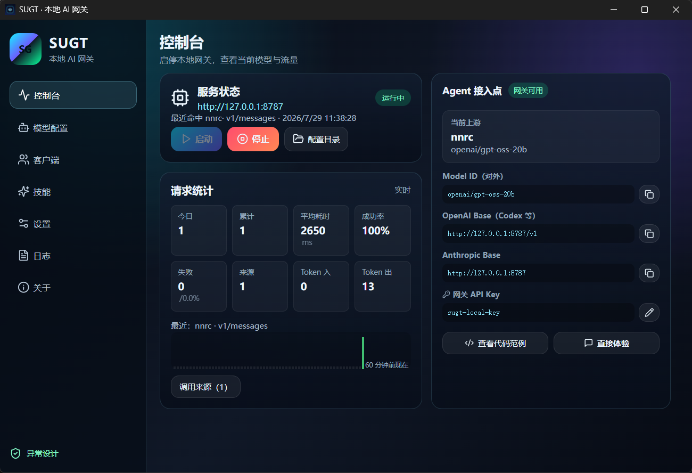
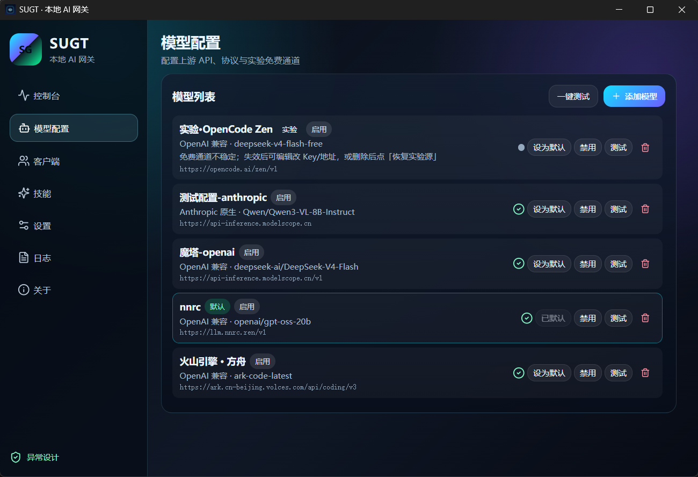
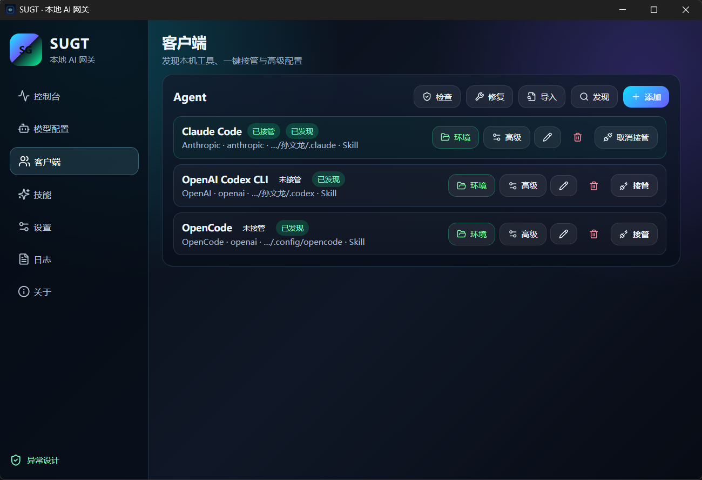
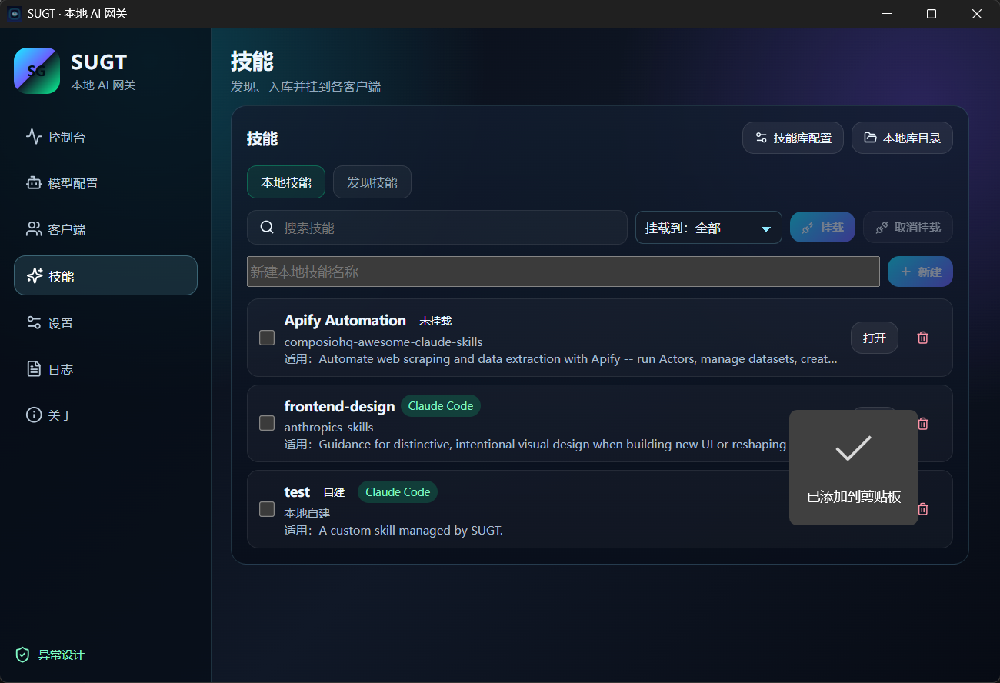
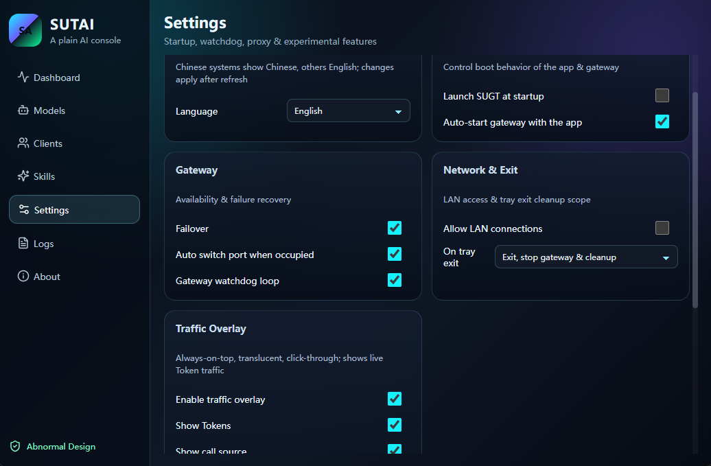
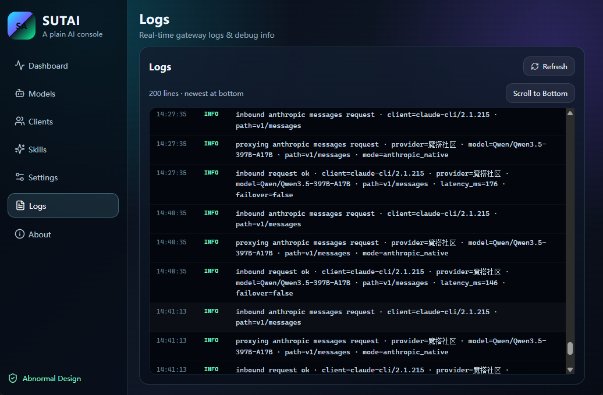

# SUGT — 本地 AI 网关 & 大模型技能中控台

> 前段时间饭碗被砸，正琢磨要不要去送外卖，一时半会儿腾不出手再维护了。代码已全开源，自己玩就好；星不多，我也懒得做流量推广——要是帮到你、又愿意的，求顺手推广一下。

**SUGT（su gateway）** 是一款本机 AI 网关与技能中控台。集中管理多个 LLM 服务商的 API Key（OpenAI、Anthropic、魔搭、火山引擎、硅基流动、Moonshot Kimi、DeepSeek、DashScope、自建模型），通过本地 OpenAI / Anthropic 兼容代理，让 Claude Code、Codex、OpenCode 等 AI 编码客户端统一接入本机端点，并在一个面板里切换上游模型；同时提供可发现、可安装、可挂载的技能（Skills）中控台，卸下也不会丢库。

- **一套 Key，处处可用**：所有 AI 客户端的 Base URL 与鉴权，收拢到本机一个网关。
- **上游随意换**：OpenAI、Anthropic、魔搭、火山引擎、硅基流动、Moonshot Kimi、DeepSeek 或自建模型，切换无需改动任何客户端。
- **技能不乱丢**：统一发现、安装、挂载；卸载挂载也不会丢掉技能库。

| | |
| --- | --- |
| 作者 | 孙文龙 · [异常设计](https://github.com/lsuen) |
| 开源 | [Apache-2.0](LICENSE)，全仓库开源 |
| 下载 | [GitHub Releases](https://github.com/lsuen/sugt/releases) |

English: [README.md](README.md)

## 许可

[GitHub Releases](https://github.com/lsuen/sugt/releases) 上的安装包就是完整功能：本地 AI 网关、协议互转、客户端接管、技能中控台，以及应用内的 SOUL / 小su。源码为 Apache-2.0。

## 为什么需要

- **Key 分散**：OpenAI、Anthropic、魔搭、火山引擎、Moonshot Kimi、DeepSeek、本地模型散落在各客户端，难以统一管控。
- **Agent 各配一套**：Claude Code、Codex、OpenCode 各自都要写 Base URL 和鉴权，繁琐易错。
- **Skills 散落**：没有统一发现 / 挂载 / 保留机制，换机器就要全部重来。

SUGT 刻意保持小巧：一个兼容的本地网关、常用 Agent 一键接管，以及一个能真正留住不丢的技能中控台。

## 功能特性

### 本地 AI 网关（Gateway）

- 在 Tauri 进程内启动 Axum HTTP 服务器，同时支持 **OpenAI Chat Completions**、**Anthropic Messages**、**OpenAI Responses** 三种协议
- **协议互转**：Anthropic 与 OpenAI 之间的请求 / 响应双向转换，含 SSE 流式
- **多上游故障切换**：按 `failover` 配置顺序自动回退到下一个服务商
- **配置热加载**：修改 `config.toml` 后下一次请求即生效，无需重启
- **端口兜底**：端口被占用时自动绑定下一个可用端口
- 内置路由：`/health`、`/v1/models`、`/v1/_sugt/traffic`、`/v1/_sugt/workspace-rules`、`/v1/_sugt/notify`

### 模型管理

- 内置国内服务商目录（魔搭、火山引擎、硅基流动、Moonshot Kimi、DeepSeek 等），提供标准 Base URL 与模型列表
- 启停服务商、切换默认模型、一键测连通性
- 实验免费通道：打开控制台或选中该上游时自动探测一次（无后台定时轮询）；需要时可手动刷新

### 客户端一键接管

- 自动发现本机已安装的 Agent 客户端
- Claude Code / OpenCode：写环境变量与启动脚本指向本机网关；解除接管时清理干净
- **Codex（CLI / Desktop）**：写入 `~/.codex/config.toml` 的 `model_providers.sugt` 与 `wire_api = "responses"`（新版 Codex 往往忽略纯环境变量）。上游若无原生 Responses，网关会做 Responses → Chat 回落：提起 `additional_tools`、保留 function/custom 工具，并把 `reasoning_*` 与可见正文分开

### SOUL / 小su

- **SOUL** 页里的轻量伙伴——是这款软件的灵魂与本体，不是另起一套「网关代理」
- 可聊天、在本地项目目录建小项目、写文件，以及改应用或系统配置（写入前会先确认；macOS 默认在 `~/Library/Application Support/sugt/projects/`，避开 iCloud 文稿）
- 可选**自动同意写入**（信任会话时用）；写入后会再读一遍文件核对
- 过长的终端输出会裁掉头尾保留，大项目里上下文更稳
- 经本机网关，用**你配置的上游大模型**替小su思考；支持粘贴截图（需上游支持视觉）
- 按工作目录分别保留对话；可中途停下；重活可交给 Claude Code 或 Codex

### 技能中控台

- 从 Git 仓库、Gitee、自定义源刷新技能索引
- 安装、卸载、挂载、取消挂载——技能库永远保留
- 同一技能可挂载到多个 Agent；Markdown 渲染的技能面板

### 流量悬浮窗

- 置顶 + 半透明 + 鼠标穿透，实时显示今日 Token 交互
- 支持横竖排布局、尺寸调节与一键恢复默认
- macOS：悬浮窗位置与鼠标穿透按本机桌面行为工作

### 全局规则

- 独立页面，规则正文、文档习惯、Webhook 三个开关互不影响
- 规则正文和已启用的文档习惯会注入到经网关的 OpenAI / Anthropic / Responses 请求；这是软约束，不能保证客户端一定读文件或写回
- 全新配置会放好一段通用规则（开关默认关闭，打开后才注入），并默认勾选 `AGENTS.md` 与 `docs/MAP.md`。填写「作用与说明」后会随该条一起注入
- Webhook 默认关闭。地址只留在本机，由 `/v1/_sugt/notify` 代发，不会进入模型上下文
- 已保存过的规则和勾选不会被新默认值覆盖。Windows 与 macOS 共用同一套注入和代发逻辑

### 网关守护

- 看门狗每 20 秒检测网关可达性，不可达时自动拉起
- 独立 `sugt-cli serve` 进程管理（PID 文件 + 无窗口后台进程）

### 外观 / 主题皮肤

- 内置：赛博控制台、街头粉笔、滑板场、嘻哈砖墙、山水墨、HIPHOP、爵士夜，以及带插画背景与毛玻璃的 **二次元男 / 二次元女**
- 每个主题独立文件（或 JSON 主题包），固定约 40 个令牌契约；支持背景图、透明表面、毛玻璃
- 设置 → 外观 切换；可导入 `theme.json` 自定义皮肤
- 制作说明：[docs/THEME_AUTHORING.zh.md](docs/THEME_AUTHORING.zh.md) · Agent 约定：[AGENTS.md](AGENTS.md)

## 界面预览

控制台：启停、流量、接入点。



模型：多服务商、默认切换、测连通性。



客户端：发现本机 Agent，一键接管 / 取消接管。



技能：本地挂载与仓库发现。



设置：语言、网关与悬浮窗选项。



日志：请求与网关活动。



## 国际化（Internationalization）

SUGT 内置 **中文 / English** 双语支持，所有界面文本均通过统一的字典层渲染，不依赖任何第三方 i18n 库（零额外依赖）。

**语言切换方式**：打开「设置」→「语言」，在「跟随系统 / 中文 / English」三者间选择。

| 选项 | 行为 |
| --- | --- |
| 跟随系统 | 检测系统语言，中文系统显示中文，其余显示英文（默认） |
| 中文 | 固定显示中文 |
| English | 固定显示英文 |

切换后立即刷新界面，所有面板、弹窗、提示、悬浮窗文字实时生效，无遗漏。选择会持久化到本地，重启后保持。

**实现要点**：

- 文案集中在 `src/i18n.ts` 的 `zh` / `en` 两套字典中，组件内通过 `t('namespace.key')` 取值，便于统一维护与扩展
- 支持 `{变量}` 占位插值，动态文本（如 Token 数、服务商名、路径）可安全拼装
- 语言偏好存储在 `localStorage`，与主题等界面偏好一致
- 新增语言只需扩展字典即可，无组件级改动

## 快速开始

### 下载安装

**Windows（winget）**：manifest 合并上游后：

```bash
winget install lsuen.SUGT
```

**Windows（直装）**：前往 [GitHub Releases](https://github.com/lsuen/sugt/releases) 下载 NSIS 安装包（`SUTAI_*_x64-setup.exe`）或 zip。

**macOS（Homebrew）**：开源 tap 预编译 cask：

```bash
# 首次安装
brew tap lsuen/homebrew-sugt
brew trust lsuen/sugt        # 一次性：信任本开源 tap
brew install --cask sugt

# 以后更新
brew update
brew upgrade --cask sugt
```

从「应用程序」打开 **SUTAI**。应用未签名：首次启动请右键 →「打开」，或执行 `xattr -cr "/Applications/SUTAI.app"`。

配置目录：Windows / Linux 默认 `Documents/.sugt/`；macOS 默认 `~/Library/Application Support/sugt/`（若文稿已进 iCloud，会从旧的 `Documents/.sugt` 自动迁过去）。可用环境变量 `SUGT_CONFIG_DIR` 覆盖。

### CLI

```bash
sugt-cli status
sugt-cli serve --host 127.0.0.1 --port 8787
sugt-cli env        # 接管管理
sugt-cli test       # 连通性测试
```

> macOS 上 CLI 内置于应用包：`SUTAI.app/Contents/MacOS/sugt-cli`。

## 从源码构建

需要：Windows 10/11、Node 18+、Rust 1.78+。macOS 需要 Xcode Command Line Tools 与 Node。

```bash
npm install
npm run check        # TypeScript 类型检查
npm run dev:app      # 启动 Tauri 桌面应用（开发模式）
```

生产构建：

```bash
npm run build        # 前端生产构建
npx tauri build      # 完整桌面应用打包
cd src-tauri && cargo build --release --bin sugt-cli   # 独立 CLI
```

## 技术栈

| 层 | 选型 |
| --- | --- |
| 桌面壳 | Tauri 2.9（Windows 用 WebView2 / macOS 用 WKWebView） |
| 前端 | React 18 + TypeScript 5.7 + Vite 6 |
| 后端 | Rust (edition 2021) + Axum 0.7 |
| 网关 | 内嵌 Axum HTTP 服务器，OpenAI / Anthropic 协议互转 |
| CLI | `sugt-cli`（独立二进制，支持 `serve` / `status` / `test` / `env` / `init`） |

## 反馈与参与

有问题或建议，欢迎开 [Issues](https://github.com/lsuen/sugt/issues)。项目持续打磨中，Star 是对作者最大的鼓励。

## License

[Apache-2.0](LICENSE) · [NOTICE](NOTICE)
